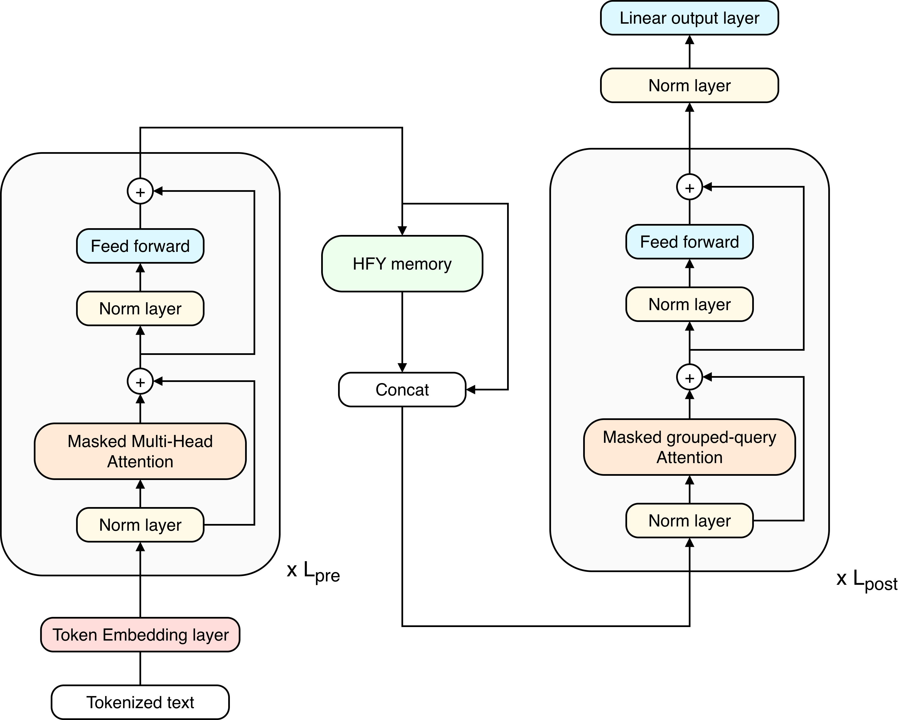

# Late Interaction Hopfield-Fenchel-Young Networks for Sparse Retrieval of Language Model Hidden States

**Read the full blog post:**
[Late Interaction HFY Networks](https://oriolac.github.io/posts/20261111-hfy-late-interaction/)

## Motivation

This project investigates how **Hopfield-Fenchel-Young (HFY) networks** can retrieve token-level representations through
late interaction, preserving fine-grained semantic information without compressing entire sequences into single
embedding vectors.

Specifically, we explore hidden states extracted from **Qwen3.5-4B** and investigate whether retrieved associative
memories can be injected directly into the language model's intermediate representations to support context-grounded
generation.

The approach combines two complementary mechanisms:

- **Late interaction** computes similarities between token-level sequences, preserving fine-grained alignments between
  queries and stored memories.
- **HFY associative retrieval** transforms these similarity scores into sparse memory-selection weights through a
  regularized optimization framework.

### Potential Advantages

The proposed approach offers several potentially interesting properties:

1. **Token-level memory preservation.** Memories are stored as contextualized token representations rather than pooled
   sentence embeddings, retaining fine-grained information that might otherwise be lost during aggregation.

2. **Unified retrieval and generation representations.** The same token-level hidden states support both associative
   retrieval and memory injection, eliminating the need to maintain separate embedding representations or train an
   additional retrieval projection.

3. **Direct hidden-state integration.** Retrieved representations can potentially be incorporated into the language
   model's intermediate hidden states, allowing external information to influence generation without reconstructing
   retrieved memories as natural language.

4. **Training-free retrieval.** The current implementation exploits representations from a pretrained language model
   without additional parameter training, enabling the investigation of associative retrieval independently of
   retrieval-specific fine-tuning.

## Current Limitations and Future Directions

This work is an exploratory proof of concept, and several challenges remain open.

**Hidden-state compatibility.** Since no post-training methods are involved, injecting external representations into
intermediate transformer layers does not fully guarantee that the language model will interpret them as exact meaningful
contextual information. Post-training strategies of generative language models could be a new future research direction.

**Independent contextualization.** Query and memory sequences are processed independently before injection, preventing
cross-sequence interactions in earlier transformer layers. Moreover, representations extracted from earlier layers may
not capture all the semantic and contextual information required for effective generation. Greater models would benefit
better from this architecture. A study comparing model sizes could be interesting and it can contribute significantly
this research.

**Memory-length constraints.** The current implementation aggregates retrieved information into a query-aligned
representation, producing one memory vector per query token. Consequently, information from longer memories must be
compressed into the query's sequence length, potentially limiting information preservation.

Potential research directions include preserving complete memory token sequences during injection, investigating
encoder-decoder architectures, and jointly training language models with HFY-based associative memory mechanisms.

## Contact

This project is an exploratory proof of concept. Discussions, feedback, and potential research collaborations are
welcome.

**Email:** [oriol.alas@eurecat.org](mailto:oriol.alas@eurecat.org)